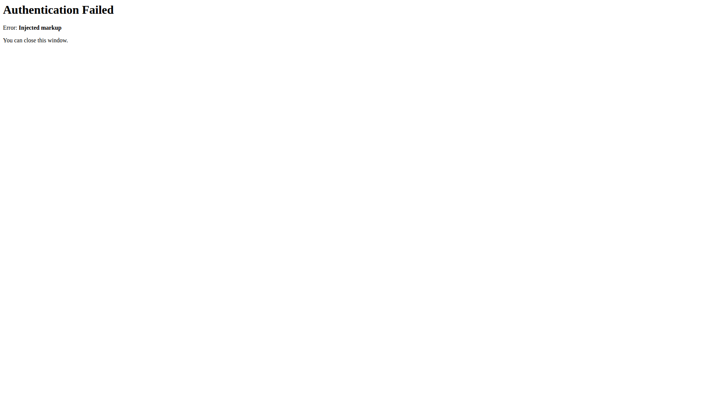
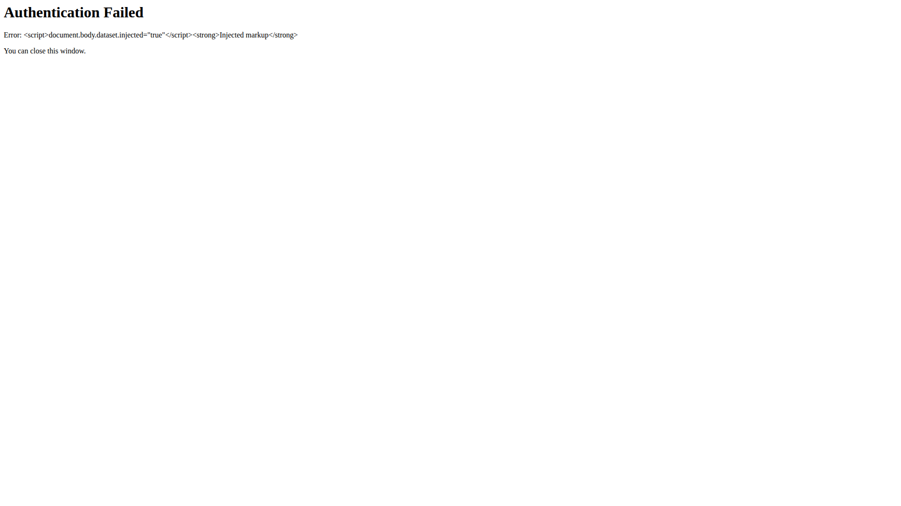

Fixes #340

The cited runs included genuine dependency drift, a closed pin exception, deprecated transitive packages, and an older model failure already fixed by #339. This change fixes those findings and the validation/release gaps reproduced during the complete template audit.

- Apply relevant-change detection, frozen installs, fresh merge validation, strict version/docs/source-size checks, and consistent cancellation across all workflows. Split the three oversized TypeScript modules, and verify their runtime bindings.
- Verify publishing credentials before builds; require successful quality gates and main-only publishing. Queue writers, reject untested source/dependency changes, preserve release rerun recovery, and distinguish push races from rule/auth failures.
- Load release helpers from the committed lockfile, enable strict command failures, and verify exact release existence before skipping failed API writes. Match changelog versions literally and pass commit messages as direct Git arguments.
- Refresh dependencies and lockfiles, remove the closed lino-arguments exception, replace deprecated development transitive dependencies, and keep genuine registry/tool failures fatal. Preserve diagnostic artifacts even when setup fails.

The [audit and requirement matrix](https://github.com/link-assistant/agent/blob/issue-340-8f7dd340a8ef/dev/log/issues/340/pulls/341/ANALYSIS.md) includes the timeline, root causes, alternatives, all 17 CI principles, primary-source research, raw logs/metadata/artifacts, and comparisons of all 941 pinned template file contents (including 227 CI/configuration files).

Reproduction and verification:

- `node experiments/issue-340/reproduce-before-after.mjs` proves the original docs-only rejection and missed 1501-line TypeScript violation against the fixed guards.
- `node experiments/issue-340/release-notes.mjs` reproduces lost notes for valid SemVer build metadata in the original release script and verifies the corrected payload without network requests.
- 172 focused tests cover credentials, freshness, docs/runtime Markdown, hook failures, version guards, dependency-preserving lock edits, staged release boundaries, status gates, release recovery and real concurrent Git push races. The source-race test verifies no release version/tag reaches origin.
- ESLint, Prettier, actionlint, documentation and source-size checks pass locally. Full JavaScript OS tests, Rust lint/test/build, clean packed installation, live verbose logging, security, links and model checks run in CI. Completed CI exposed a packed-parser prepare-path failure after unit tests passed; its package-local entry and isolated-copy regression are included. All eight workflows and the separate CodeQL summary pass at `354f390`: 39 checks pass and five expected jobs skip. The earlier summary failure is preserved alongside its two fixes and zero-annotation follow-up. The final evidence-only commit also receives a current-head check review before readiness.
- JS patch changeset and Rust patch fragment prepare CI-managed releases; no manual package version changes.

Shared defects reported with finite reproductions, workarounds and suggested code/tests:
[JS cancellation #289](https://github.com/link-foundation/js-ai-driven-development-pipeline-template/issues/289),
[Rust cancellation #230](https://github.com/link-foundation/rust-ai-driven-development-pipeline-template/issues/230),
[Python cancellation #140](https://github.com/link-foundation/python-ai-driven-development-pipeline-template/issues/140),
[JS hook installation #290](https://github.com/link-foundation/js-ai-driven-development-pipeline-template/issues/290),
[Rust source synchronization #231](https://github.com/link-foundation/rust-ai-driven-development-pipeline-template/issues/231).

Live registry publication is main-only; PR checks use mocked credential probes and report mode. Actual crate ownership is finally enforced by cargo publish.

CodeQL review findings are also fixed: the real OAuth callback encodes error text,
and Cloud Code routing requires the exact Google HTTPS host. Regression tests
exercise the actual callback and shared URL transformer.

Browser verification with the same local injection payload:

| Before: injected script executes | After: payload displayed literally |
| --- | --- |
|  |  |
